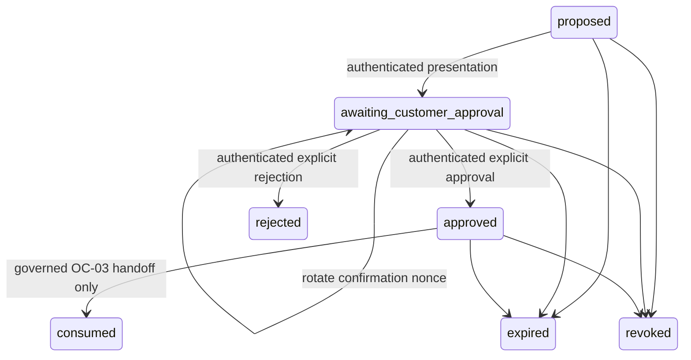

# OC-02 customer authorization — engineering and OC-03 handoff

Implemented as isolated backend modules. **No action executes.** No HTTP routes,
customer UI, runtime imports, production flags, deployments, existing migrations,
or release candidates are changed. CI-05 and OC-01 remain unchanged.

Base: OC-01 / draft PR #730, exact commit
`c893f40b0d4115049a02f4e74f142eece0261046`. Isolated worktree `C:/oc02`, branch
`oc/oc-02-action-authorization`. This PR must target
`oc/oc-01-read-only-tool-broker`; do not merge either draft during integration.

## Modules and supported capabilities

All implementation modules are under
`supabase/functions/_shared/corporateIntelligence/customerAuthorization/`:

| Module | Exports and responsibility |
| --- | --- |
| `contracts.ts` | Frozen `REGISTRY`, `VERSION`, `POLICY`, transition graph, strict intent parser, persisted-state validator, snapshot/target types and digest |
| `repository.ts` | `Repository`, `PostgresRepository`, transactional driver contract, `MemoryRepository` for reference/tests only |
| `service.ts` | `createAuthorizationService`, `modelProposalSummary`, authenticated approval, denial, status, revocation and governed handoff interfaces |
| `service.test.ts` | Adversarial state/authorization/race tests, automatically discovered by the existing backend runner |

`__tests__/oc02AuthorizationPersistence.test.js` executes the actual TypeScript
service/repository and proposed SQL in local PGlite using the existing TypeScript
transpiler and SQL-test dependencies. No new dependencies are added.

Version: `oc02-authorization-v1`; policy: `oc02-policy-v1`.

| Capability | Required target | Additional entitlement |
| --- | --- | --- |
| `save_watchlist` | Current authorized durable product record | Current K+ policy |
| `save_closet` | Current authorized durable product record | None in this draft |
| `update_saved_preference` | Actor/account-owned saved product | None in this draft |
| `pause_watch` | Actor/account-owned watch | Current K+ policy |
| `remove_watch` | Actor/account-owned watch | None in this draft |

Every capability requires current AI-processing consent, an active account,
capability permission, a freshly checked target, an explicit authenticated customer
operation, and actor/account-scoped idempotency. The registry grants no customer
runtime exposure. Purchases, payments, messaging, registration, checkout, raw
database operations and external commitments are absent. No executor dependency or
account/product/watch mutation API exists.

## Proposal and lifecycle

The model may supply only:

```json
{
  "version": "oc02-authorization-v1",
  "capability": "save_watchlist",
  "arguments": { "targetRef": "p_eeeeeeee-eeee-4eee-8eee-eeeeeeeeeeee" }
}
```

References use the existing OC-01 `p_<UUID>` shape for products and closed
`saved_<UUID>` / `watch_<UUID>` shapes for owned resources. Preferences are limited
to `notify_price_drop`, `notify_restock`, or `none`. The model cannot supply a
proposal ID, actor/account, approval, credential, provider, URL, product description,
product payload, policy version, expiry, token, arbitrary preference or operation ID.

`propose` accepts a separate server-generated retry operation ID. It resolves an
authorized durable target, creates an unpredictable server UUID, copies a closed
snapshot, and computes its SHA-256 digest with deterministic key ordering. The
snapshot binds actor, account, capability, exact arguments, durable product/resource
identity and revision, approved-source provenance, policy and permission revision,
creation/expiry and retention. Persisted records are independently schema- and
digest-validated before customer operations. Returned objects are copies; mutating
them cannot alter stored authorization.



Rejected, expired, revoked and consumed are terminal. `consumed` means authorization
was handed off, **never that an account action completed**. Every API completion
record explicitly returns `executed: false`. Invalid edges, stale revisions,
argument/snapshot changes and expired windows fail closed.

Maximum proposal life is 120 seconds, shortened by the target's validity horizon.
The target must have been checked within 30 seconds at creation, and must be freshly
resolved again at presentation, approval and handoff. Expiration is enforced on
every authorizing operation and by the SQL trigger at database time; the expired
state is materialized when encountered. No background expiry worker is introduced.
Records/receipts/audit have a proposed seven-day retention horizon; scheduling
`Repository.purge` remains a future integration responsibility.

## Trusted dependencies and OC-01 bridge

Construct the service with `Dependencies` from trusted server code only:

- `enabled`: omitted or anything except literal `true` is OFF. No environment
  variable or runtime reader is introduced. Future integration owns an independent,
  explicit, default-OFF rollout gate.
- `authenticate(Request)`: validate actual authentication using the existing
  verified-user guard; resolve account membership from authoritative server records.
  Never derive account/permissions from model arguments, request-body claims or
  user-editable metadata. Non-anonymous identity and valid UUIDs are mandatory.
- `assertActive`: bind the existing current account-active guard.
- `authorize`: fetch current consent, capability permissions, applicable entitlement
  and a permission revision/epoch. A changed epoch invalidates the proposal. A
  boolean model claim cannot satisfy this dependency.
- `resolveTarget(actor, intent, previous?)`: on creation, resolve an OC-01 reference
  from an actor/account-bound **server-held** result index, verify its provenance
  and freshness, and rehydrate an authorized durable product/resource record.
  Raw provider cards or client-echoed products are insufficient. On subsequent
  calls the service supplies its trusted previous durable identity, allowing a
  current record lookup after the ephemeral OC-01 result cache expires. Return only
  current eligible records; resource ownership must match the account. The service
  compares product ID, record ID/revision, owner and provenance with the immutable
  snapshot. It rechecks permissions again after resolver I/O.
- `verifyCustomerOperation`: future native confirmation-route/channel protections,
  including applicable CSRF/session/native requirements. This route must never be
  a Gemini tool or conversation parser. An API request represents the explicit
  customer operation; the backend does not claim cryptographic proof of a screen tap.
- `verifyHandoffService`: independently verify the future OC-03 service principal,
  in addition to customer actor/account authorization. Omitted means handoff is denied.
- `repository`: explicit durable binding; there is no automatic memory fallback.

No authoritative product table, account hierarchy, entitlement implementation or
Watchlist/Closet schema is invented here. Those resolver/guard bindings remain
integration dependencies. If an approved provider card has no authorized durable
record, it cannot become an actionable target merely by being displayed.

Only `modelProposalSummary` belongs in a model turn. It contains closed capability
and lifecycle codes, confirmation-required and `executed: false`. Full records,
actor/account IDs, policy evidence, permission epochs, target details, snapshot
digests and confirmation tokens are server/app data, not model context.

## Future mobile confirmation contract

These are service interfaces, **not implemented routes or frontend code**:

1. `inspect(GET request, proposalId)` returns an authenticated, account-scoped
   status/revision/digest/argument summary. It exposes no nonce, nonce hash, actor,
   permission revision or authorization evidence. It can materialize expiration;
   it never grants approval. This supports lost-response recovery and polling.
2. `present(POST JSON request, {proposalId, expectedRevision, operationId})` requires
   current active account, permissions and target validity. It transitions to
   awaiting approval and returns the exact immutable details, policy, expiry,
   revision, digest and an unpredictable confirmation token. The token is returned
   only to the authenticated future confirmation component; storage retains only
   its digest. The frontend must display the actual immutable selected action/details.
3. `decide(POST JSON request, {proposalId, expectedRevision, snapshotHash,
   operationId, decision: 'approve' | 'reject', confirmationToken})` independently
   verifies the full binding. Chat statements such as “yes”, “do it” and “go ahead”
   are invalid. No model approval token is accepted.
4. `revoke(POST JSON request, {proposalId, expectedRevision, operationId})` records
   an owner-authorized terminal revocation. Rejection/revocation remain possible
   without renewed AI consent, while the account must remain active.

Client operation IDs are UUID retry identifiers, not authorization evidence. An
exact retry of a committed decision returns its existing receipt/current compatible
state without creating another approval. Changed payloads under the same ID fail;
a new ID cannot replay a consumed/rejected/revoked authorization. Approve retries
still recheck current consent, permission, target and expiry. Rejection retries may
return their prior non-authorizing terminal result after expiry.

If presentation response delivery is lost, inspect the current revision and issue
a **new** presentation operation. This rotates the nonce and invalidates the old
token/revision. Tokens are not recoverable from storage and must never enter chat,
analytics, crash reports or logs. Competing presentation/approval requests cannot
both win the same revision. A proposal rejected or changed by the customer requires
a new proposal and confirmation, rather than an in-place argument update.

## Persistence actually implemented and tested

`PostgresRepository` uses a real `Database.transaction` callback on one SQL
connection. Do **not** implement that interface as separate Supabase REST calls.
The adapter uses fixed, parameterized SQL; neither the model nor API body chooses
SQL, RPC names, schema, table, connection or credentials.

The proposed SQL is
[`20261104163311_oc02_customer_authorization_proposed.sql`](20261104163311_oc02_customer_authorization_proposed.sql).
It was created with the Supabase CLI and deliberately moved under docs, **outside
`supabase/migrations`**, so existing migration/deploy tooling cannot apply it.
Nothing has been applied to Staging or Production.

Four private tables store proposals, receipts, metadata audit and per-actor rate
buckets. No public approval RPC is introduced. Customer roles have no schema/table/
function access; all tables enable and force RLS with backend-only policies. A
SECURITY INVOKER trigger independently pins immutable snapshots/ownership/expiry,
checks state edges and revisions, and rejects expired approvals/handoffs. Receipt
foreign keys bind proposal, actor and account; retention deletion cascades receipts
and audit. There is no dependency on an assumed existing account/product schema.

The repository serializes operations on the actor's rate row, then locks the
proposal row, validates the revision and immutable snapshot, and writes state,
idempotency receipt and audit **in one transaction**. Per-actor limits cover all
accounts: 30 attempted authenticated operations per database minute, including
invalid payload attempts and retries. An interrupted commit rolls back all three
writes; retrying a lost acknowledgement uses the retained idempotency receipt.

Local PGlite tests prove execution of the actual SQL/adapter, one-winner logical
concurrency, atomic rollback/retry, SQL access denial, independent trigger guards,
database-clock expiry and on-disk close/reopen persistence. PGlite serializes its
single connection: this is **not** a deployed Supabase or multi-connection PostgreSQL
concurrency/crash certification. `MemoryRepository` proves reference behavior only
and has **no durability guarantee**.

Before persistence activation, the integration owner must review/register the
proposed schema as a governed migration, bind a real transactional connection,
verify grants/roles/RLS on the target database, and choose approved account-deletion,
retention cleanup, connection deadline and operational recovery policies. No new
credential or environment handling is included in this branch.

Row locks must remain within the same transaction; see the
[PostgreSQL locking contract](https://www.postgresql.org/docs/17/explicit-locking.html).
Backend credentials are not a substitute for actor/account authorization;
[Supabase documents service-role RLS bypass](https://supabase.com/docs/guides/database/postgres/row-level-security).

## Audit and operational limits

Durable audit metadata contains only closed version/capability/from-state/to-state
codes and revision. The private audit table has a proposal foreign key for internal
recovery; public telemetry has no identifier. Optional `emit` is best-effort
transition telemetry and may repeat on idempotent transport retries; durable audit
does not duplicate transitions. `emitDenied` contains only a version and closed
failure code. No customer message, image, actor ID, merchant evidence, token, raw
dependency error, SQL error text or target content is logged. Failure to emit
telemetry cannot approve anything or change a committed result.

The module performs zero Gemini and zero paid-provider calls. It introduces only
its own proposal/rate/receipt/audit persistence. No Watchlist/Closet/account mutation,
payment, merchant contact, registration or external effect occurs. No customer path
imports it, and the default-OFF gate returns before auth/storage work.

## OC-03 execution handoff and remaining verification

`handoff(request, {proposalId, expectedRevision, snapshotHash, operationId})`
requires both the independently governed service principal and current customer
authorization. It resolves the target again, verifies its immutable identity,
policy, permission epoch and expiration, and atomically transitions approved →
consumed. It returns a stable `handoffId` and `executed: false`. Only one fresh
operation may consume the authorization; exact receipt retries recover the same
handoff while the authorization remains valid.

The OC-03 execution service must independently recheck current identity/account,
consent, capability permission/entitlement, policy, target eligibility/revision,
expiry and prior execution. It must bind that resource/permission revision check
to its actual mutation transaction and persist its own execution idempotency and
completion evidence. OC-02's guard/resolver callbacks are outside its proposal
storage transaction; it does **not** claim atomic serialization of external
permission/catalog changes with the future mutation. A consumed handoff is not an
execution result, an external commitment, or a reusable grant. If recovery crosses
expiry or revocation, fail closed and reconcile prior effects before any new action.

Remaining runtime work belongs to future integration: authenticated routes and
native confirmation UI, durable product/resource resolver and policy bindings,
transactional DB driver, authorized migration/cleanup review, rollout gate,
multi-connection PostgreSQL verification, and OC-03 mutation/completion service.
Use Playwright later for the customer-facing candidate confirmation workflow.
TestSprite is not introduced as a release gate.

Rollback before integration is to leave the new gate OFF and omit all imports.
Neither OC-01's read-only broker nor Option B's non-executing contracts are modified.
No current Scanner, StyleChat, discovery or candidate entrypoint is touched.

## Validation commands

- `deno test --node-modules-dir=none supabase/functions/_shared/corporateIntelligence/customerAuthorization/service.test.ts`
- `node --test __tests__/oc02AuthorizationPersistence.test.js`
- `node scripts/run-backend-tests.js _shared black-owned-discovery scan-identify stylechat-generate`
- The existing backend-authority, migration-authority, actor-scope,
  provider-settlement and security baseline/applicability governance suites.
- `deno lint` and `deno fmt --check` for the new modules; `git diff --check`.

Exact final counts and CI status are recorded in the stacked draft PR. Offline
passing checks do not authorize any runtime activation or production deployment.
