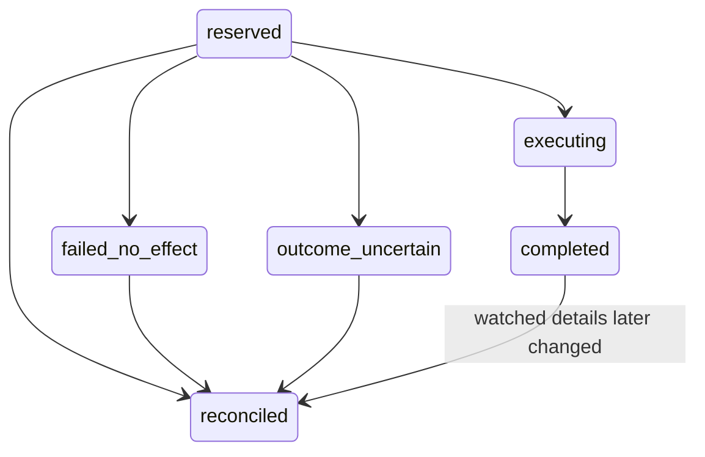

# OC-03 — governed Watchlist execution and recovery

Isolated backend implementation, disconnected from customer paths. No deployment,
activation, live account mutation, environment/secret change, active entrypoint edit
or candidate work is authorized or performed here.

Base: `oc/oc-02-action-authorization`, exact OC-02 commit
`df31888beb7410f6e5800d378a2536b653a2aac7` / draft PR #731. Worktree `C:/oc03`,
branch `oc/oc-03-governed-action-execution`. Stack this draft on #731; do not merge
the OC stack into governed/release branches during the concurrent activation pass.

## Implemented capability and modules

Only **`save_watchlist`**, with explicit **`just_watching` and no target price**, is
executable. No price alert is armed. Other OC-02 capabilities remain non-executing.
No purchases, checkout, payments, messages, registrations, external commitments,
deletion, bulk action or arbitrary RPC/tool execution is introduced.

New modules under
`supabase/functions/_shared/corporateIntelligence/governedExecution/`:

| Module | Interface |
| --- | --- |
| `contracts.ts` | Frozen capability allowlist, proof command parser, execution/binding/evidence/status contracts |
| `watchlist.ts` | Existing capability/URL/price normalization, exact-intent no-op checks, existing Watchlist RPC adapter |
| `store.ts` | Scoped fixed SQL, proposal/binding/ledger validation, committed attempt quotas, metadata audit |
| `coordinator.ts` | `createGovernedWatchExecutor(Dependencies)`; `present`, `decide`, `reserve`, `execute`, `status`, `reconcile` |
| `contracts.test.ts` | Strict requests, default-OFF and principal/identity/proof tests |

`__tests__/oc03GovernedExecution.test.js` uses the isolated PGlite environment in
`__tests__/helpers/oc03ExecutionWorld.js`. It executes actual OC-02/OC-03 source and
the actual existing Watchlist table/trigger/RPC migrations, including the changed
intent repair. Source permission/product rows and canonical entitlement predicate
implementations are synthetic fixtures; no actual merchant, customer or paid
provider is contacted. The synthetic service role models Supabase's BYPASSRLS
attribute; authenticated/anonymous roles retain their actual restricted grants.

## Exact intent approval: additional OC-03 confirmation binding

The existing Watchlist RPC can change the intent/target of an existing row. OC-02's
v1 save proposal contains a target reference, not a complete Watchlist intent. It
must not silently become approval to overwrite an existing price alert.

OC-03 therefore requires an immutable **pre-approval execution binding**, without
changing OC-02's contracts or enabling its capabilities globally:

1. Create the inert OC-02 proposal normally. It remains `proposed`.
2. Call OC-03 `present(request, {proposalId, expectedRevision, operationId})` from
   the future authenticated native confirmation route. It rehydrates a current
   authorized product and binds the exact approved retailer URL, source/listing ID,
   display snapshot, declared price/currency, `just_watching` and null target.
3. The binding is inserted **before** OC-02 transitions to awaiting approval. The
   OC-02 `present` operation runs on the same transaction connection. The response
   adds `executionVersion`, `executionHash` and the exact `watch` details to the
   existing app-only confirmation token, policy, revision, expiry and snapshot hash.
4. The future component displays those immutable details, including that no target
   price/alert is being set. Its structured approval goes through OC-03 `decide`,
   with the existing OC-02 decision fields **plus `executionHash`**. OC-02 performs
   its actual token/actor/account/snapshot/permission checks; OC-03 records the
   specific binding approval revision/operation in that **same transaction**.
5. Obtain the existing OC-02 governed `handoff` receipt. Consumed is not completed.
   OC-03 verifies its scope, exact operation hash, revision, original approval
   receipt and the separately approved execution binding before reserving work.

Existing generic OC-02 approvals, or approvals made through the old path without
an OC-03 binding approval, cannot execute. Conversational “yes”/“do it” and model
tokens cannot replace the structured customer operation. No confirmation token,
raw proposal or execution binding belongs in Gemini context.

The new component/routes are **interfaces only**, not implemented frontend or live
handlers. Native channel/session/CSRF checks remain required trusted dependencies.
OC-02's existing status/nonce-rotation recovery contract is retained; a failed or
lost presentation is refreshed with a new operation/revision. The execution binding
cannot be changed in place: changed details require a new proposal and approval.

## Execution command and trusted dependencies

Version `oc03-watch-save-v1`. Execution commands accept only:

```ts
{
  proposalId,       // server UUID
  handoffId,        // existing OC-02 handoff operation UUID
  proposalRevision,// consumed revision
  snapshotHash,    // immutable OC-02 snapshot SHA-256
  bindingHash,     // explicitly approved OC-03 execution details SHA-256
  requestId        // retry UUID; never authority
}
```

Unknown fields (including actor, permissions, capability overrides, intent/price,
URLs, products, credentials or RPC/SQL) are rejected. The model chooses none of
these authoritative records or execution permissions. Idempotency is ultimately
per proposal/handoff; changing a retry UUID cannot create another effect. Reusing
one actor/request UUID for a different proposal fails.

Required `Dependencies`:

- `database`: a real single-connection PostgreSQL transaction implementation. It
  must share the database containing OC-02 and `public.user_commerce_watches`.
- `enabled` and `authorizationEnabled`: distinct server gates, both explicitly
  true to present/approve/reserve/execute. Omitted/malformed values are OFF. No
  environment variable or reader is added here; future integration owns rollout.
- `authenticate`: existing verified customer identity; no body/model/metadata
  authority. Current Watchlist is user-owned, so this first implementation requires
  **accountId == actorId**, both verified UUIDs, non-anonymous. It refuses a separate
  account/multi-tenant context rather than inventing a Watchlist account mapping.
- `verifyExecutionPrincipal`: an independently verified internal execution-service
  principal in addition to customer identity. Required for reserve/execute/status/
  reconcile; never grant it to Gemini, a client body or a conversational tool.
- `verifyCustomerOperation`: the authenticated app confirmation route's protections.
- `lockAuthorization(sql, actor)`: lock current account, consent, permission epoch
  and entitlement source rows on the supplied connection. Return current active
  account, current AI consent, `save_watchlist` permission, current entitlement and
  the epoch matching the approved OC-02 snapshot. No cached/REST/model facts.
- `lockProduct(sql, actor, target)`: lookup by the immutable durable OC-02 record
  identity, enforce ownership/eligibility and lock its revision/source rows. Return
  the current authoritative target and retail offer. Never coerce an OC-01 similar
  web link or a client-echoed card into a verified retail record. Material URL,
  price/currency, ownership, revision or eligibility changes invalidate the binding.

The coordinator also calls the existing canonical
`watchlist_actor_is_active`, `kplus_has_active_entitlement`, and
`kplus_effective_access_state(..., clock_timestamp())` predicates. The latter
closes entitlement expiry inside a transaction whose `now()` is fixed at start.
The existing `create_user_commerce_watch` RPC retains its own K+ check.

No alternative entitlement system, Watchlist table, commerce engine or provider is
created. Existing `deriveWatchCapability` and `watchProviderForUrl` restrict the
first action to enabled, refreshable retail listings from the existing Farfetch/
KicksCrew registry. Price/currency must be declared and match the existing renderer;
no amount, currency, stock or variant fact is inferred.

## Transactions, intent safety and ledger

`reserve` durably records the intent before any Watch write. `execute` calls this
phase and then uses another transaction for the account effect and completion.
The handoff/reservation failure window is safe: consuming OC-02 does not write a
Watch; a lost reservation response can be resolved by the immutable handoff identity.
Expiry before actual mutation requires a new proposal, never a fabricated success.

The mutation transaction locks the OC-02 actor/proposal and execution ledger,
rechecks current policy/product, takes a bounded Watchlist table write lock, and
rechecks again immediately before the RPC. It then applies/verifies the exact
Watch, rechecks validity/kill switches, records immutable evidence and the durable
completion audit, and commits **all account effect and completion writes together**.
OC-02 confirmation/binding approval also uses a single real transaction; its
repository transaction callbacks are bound to the active connection, not REST.

The ledger states are:



`executing` exists inside the mutation transaction. A deferred database constraint
forbids committing it by itself, so other connections see reserved or the final
committed result. The deferred check independently verifies consumed authorization,
expiry, approved binding, current canonical account/K+ state, and the actual owned
Watch tuple/evidence before allowing completed to commit. Existing evidence and
execution identities cannot be rewritten. No account mutation is committed without
its completion ledger.

### Why a table write lock exists

The legacy RPC can INSERT after an absent-row check or UPDATE a row's intent. It
does not participate in OC-03's actor lock. A simple “select then RPC” could therefore
overwrite a concurrently created `buy_under` watch. OC-03 uses
`SHARE ROW EXCLUSIVE` for this bounded transaction to fence **all** legacy Watch
writes, including absent-row and limit races, without editing their active paths.
It permits ordinary reads but serializes Watch writers across actors.

- Existing active watch with exactly the approved source/URL/currency and
  `just_watching`/null target: authoritative `already_watched` no-op. The RPC is
  skipped; no row/version/intent is changed, even at the watch ceiling.
- Existing `buy_under`, different target/currency or paused watch: fail without
  effect with `existing_watch_change_requires_approval`. No implicit retarget,
  downgrade, resume or alert enrollment occurs. A separately governed capability
  and approval would be needed for that change.
- No existing live row: enforce the existing `MAX_ACTIVE_WATCHES_PER_ACTOR`, call
  the existing RPC, then verify the actual saved row. One action, one listing.

This conservative global write lock is an explicit throughput/refresh-contention
tradeoff requiring multi-connection/load review before rollout. Do not remove it
without an equivalent fence shared by **all** legacy writers. Lock timeout is
1,500 ms and statement timeout 2,500 ms. The driver must additionally impose a
bounded whole-transaction deadline and cancel/rollback/discard safely on timeout;
the statement limit alone is not a total JavaScript callback deadline. Guard ports
must perform only bounded SQL on that connection, never external provider calls.

Authenticated execution/status/reconciliation attempts are limited to 20 per actor
per database minute, with the counter committed separately so a rejected/rolled-back
mutation cannot refund the attempt. Confirmation uses OC-02's existing 30/minute
limit. Future UI polling must back off; no unbounded retries or new model calls.

## Status, uncertainty and recovery

Only `Status.canClaimCompletion === true` permits a customer-visible completion
claim. Neither consumed, executing, a Watch row alone, nor even a historical
completed state alone is sufficient. Status verifies the durable evidence digest
and current owned Watch identity/intent/status before returning a watch ID.

| Result | Customer interpretation |
| --- | --- |
| completed + created + completion permitted | Verified save committed |
| completed + already_watched + completion permitted | Already on Watchlist; no mutation |
| failed_no_effect | This execution transaction had no committed effect |
| outcome_uncertain | No completion/failure assertion; recover from authoritative records |
| reconciled + none | No committed OC-03 mutation evidence; do not claim success |
| completed/reconciled + watch_changed | Historical evidence retained, current watch differs; no current completion claim |

A transport/connection error never triggers a blind mutation retry. When possible,
the coordinator reopens a transaction and locks the ledger: completed proof can
recover a lost acknowledgement; otherwise uncertainty is durably recorded. If the
database is still unavailable the response remains uncertain, never false success
or definitive failure. `status` and `reconcile` require principal + owner identity
and current active account but remain available with the execution gate OFF.

Reconciliation waits for the execution row lock. In this single-database protocol,
once that lock resolves, reserved/uncertain with no completed evidence proves the
Watch/completion transaction did not commit. It records reconciled/no-effect and
does not retry the action. It does **not** claim an independently existing Watch was
created by this action. A terminal failure/reconciliation requires a new proposal
for another attempt. A confirmed reserved operation after a crash can resume only
after fresh authorization/target checks. No background worker or retry loop is added.

If a customer later changes/pauses/deletes the Watch, status stops authorizing the
current completion claim. Historical effect/evidence remains unchanged; recovery
never overwrites that later customer intent. Lost-response/repeated model-turn
requests use the same proposal/handoff and cannot duplicate or retarget the Watch.

## Proposed persistence and privilege requirements

Additional SQL:
[`20261104171120_oc03_governed_watch_execution_proposed.sql`](20261104171120_oc03_governed_watch_execution_proposed.sql).
Created with the Supabase CLI, then moved under docs, **outside deployable
`supabase/migrations`**. It depends on the unapplied OC-02 schema. No migration is
applied or registered in this workstream, and no existing migration/RPC is edited.

The private schema contains immutable confirmation bindings, the independent
execution ledger, attempt buckets and metadata-only audit. Customer roles have no
schema/table/function access. RLS is enabled/forced with backend-only policies;
functions are SECURITY INVOKER. Service role has no DELETE grant on execution
evidence, preventing accidental loss of replay protection. The ledger survives
OC-02 proposal retention cleanup; bindings follow proposal cleanup. Actor records
follow the existing `auth.users` deletion cascade. Retention, export, account
deletion inventory and controlled archival need privacy/operations approval before
the schema is adopted; do not purge execution evidence while old authorizations
can still be replayed.

The real driver must use a backend-only PostgreSQL connection/pool, not an anon
client or a service-role JWT treated as a database password. The configured role
needs the private-schema DML/select privileges in the proposal, OC-02 transactional
repository access, existing Watchlist RPC/canonical predicate EXECUTE privileges,
and privileges for the Watchlist lock/owned-row verification plus source-row locks.
The existing service-role SQL grants are reused; no customer grant or secret file
is introduced. Never expose the connection, SQL port, principal credentials or
unrestricted database methods to Gemini or the mobile client.

`Database.transaction` must BEGIN/COMMIT/ROLLBACK on one physical connection,
preserve row/table locks, and never auto-retry a callback after an uncertain COMMIT.
Rollback/discard must finish before the connection returns to its pool. Use
consistent database backups/restores for Watchlist and both private ledgers.

Locking and clock semantics are based on the official
[PostgreSQL lock modes](https://www.postgresql.org/docs/current/explicit-locking.html)
and [current-time functions](https://www.postgresql.org/docs/current/functions-datetime.html#FUNCTIONS-DATETIME-CURRENT).

## Evidence and runtime handoff

The local SQL suite proves one actual Watch insert, idempotent/concurrent calls,
intent-preserving no-ops/conflicts, expiry/withdrawal checks, default-OFF/in-flight
kill behavior, RPC/ledger crash rollbacks, lost COMMIT acknowledgement recovery,
connection/source failures, table/request/attempt limits, unbound approvals denied,
database-enforced evidence/state constraints, and on-disk reserve/restart recovery.
Synthetic entitlement/source fixtures exercise the canonical interfaces; they do
not certify the deployed entitlement catalog or permissions. PGlite serializes a
single connection, so multi-connection PostgreSQL/legacy-writer contention,
pool/network/crash behavior and capacity remain **unverified**.

Run the existing backend runner for `_shared`, Scanner, StyleChat, discovery and
`commerce-watch-refresh`; run the new SQL suite, OC-02 SQL regression, existing
Watchlist source suites and governance/security checks. No billed provider call,
Staging customer or Production account is used. No TestSprite release gate or
customer candidate/Playwright test is introduced at this backend-only stage.

Future integration owner responsibilities:

1. Reconcile/review the stacked draft after the independent activation pass; keep
   existing customer entrypoints/default paths unchanged until separately approved.
2. Review/adopt OC-02 and OC-03 proposed SQL through the governed migration process;
   bind a real transaction driver and locked authoritative policy/product sources.
3. Implement the app-only exact-intent confirmation contract and native safeguards;
   only approved binding + OC-02 handoff may reach the server execution principal.
4. Add independent, explicitly default-OFF server rollout gates. Expose status from
   the authenticated backend, never a model-controlled executor or approval tool.
5. Test real multi-connection legacy writer races, entitlement/consent withdrawal,
   transaction deadlines/connection loss, database privilege posture, retention,
   deletion and global-lock contention in an authorized isolated non-customer
   environment. Later customer-facing confirmation tests belong to that UI stage.
6. Treat `canClaimCompletion` as the completion authority. Turning execution OFF
   stops new work and can roll back in-flight uncommitted work; it does not undo a
   legitimately committed Watch. Status/reconciliation remain available. No rollback
   path deletes customer Watches or changes their later intent.

OC-01, CI-05 and OC-02 source are unchanged. No feature is described as
Production-ready merely because these isolated engineering checks pass.
